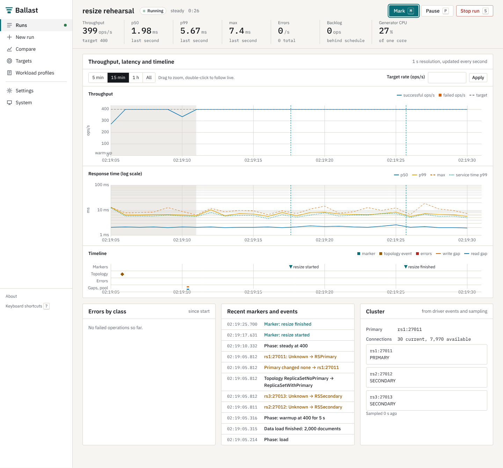

# Ballast

Ballast is a load testing tool for MongoDB clusters. It sends a steady, controlled workload, and while it runs you resize nodes, add or remove members, or trigger a failover. Ballast records what the workload experienced, second by second: throughput, latency percentiles from intended start, every failed operation by error class, topology changes seen by the driver, and the longest stretch without a successful write. For each scale operation it reports how long the disruption lasted and how long the workload took to recover.



It runs as a normal user with no root access, ships as one archive with its own Python runtime, serves its UI over HTTPS, and makes no network requests other than to your cluster.

## Five-minute quick start

Download the bundle for your platform, copy it to the server, and extract it:

```
scp ballast-1.0.0-linux-amd64.tar.gz you@server:
ssh you@server
tar -xzf ballast-1.0.0-linux-amd64.tar.gz
cd ballast-1.0.0
```

Start it. The first start creates a self-signed certificate and prints its fingerprint:

```
bin/ballastctl start
```

Ballast listens on `127.0.0.1:8443`. From your laptop, open an SSH tunnel and browse to it:

```
ssh -L 8443:127.0.0.1:8443 you@server
```

Then open `https://localhost:8443`, accept the self-signed certificate after checking the fingerprint, and:

1. Go to **Targets**, add your connection string, and press **Test connection**.
2. Go to **New run**, pick the target and a database name for benchmark data, choose a workload, and start the run.
3. While it runs, press **M** to add a marker, or run `bin/ballastctl mark "resize started"` on the server next to your scale command.
4. Stop the run. The report shows the impact of each marked window.

To listen on all interfaces instead of using a tunnel, set `server.listen: 0.0.0.0:8443` in `config/ballast.yaml`, add the server's address to `tls.self_signed_hosts`, and set an access token (`server.access_token_file`). See `docs/OPERATIONS.md`.

## Documentation

| Document | Contents |
|---|---|
| `docs/INSTALL.md` | Bundle install, install from git, upgrade, uninstall, all without root |
| `docs/CONFIGURATION.md` | Every configuration key, its default, and its environment variable |
| `docs/OPERATIONS.md` | Start, stop, logs, autostart, certificates, backup, troubleshooting |
| `docs/SCALE-TESTING.md` | Running a workload around scale operations and reading the impact analysis |
| `docs/METHODOLOGY.md` | How latency is measured, percentiles, coordinated omission, client-bound runs |
| `docs/AUDIT.md` | Audit of the previous version of this tool |
| `docs/DECISIONS.md` | Decisions made during the redesign |
| `docs/VERIFICATION.md` | Test results and the fresh-host test |
| `docs/LEGACY.md` | The original dashboard, still available behind a flag |

## Building from source

```
git clone https://github.com/pagombin/MongoDB-LoadTest.git ballast
cd ballast
make build
bin/ballastctl start
```

`make build` downloads a private Python runtime into `runtime/` and installs the pinned dependencies there; nothing is installed system-wide. `make release` builds the bundles. `make test` runs the unit tests.

## License

Copyright Paul Agombin. All rights reserved. See `LICENSE`. Third-party components are listed in `THIRD_PARTY_NOTICES` inside each bundle.
